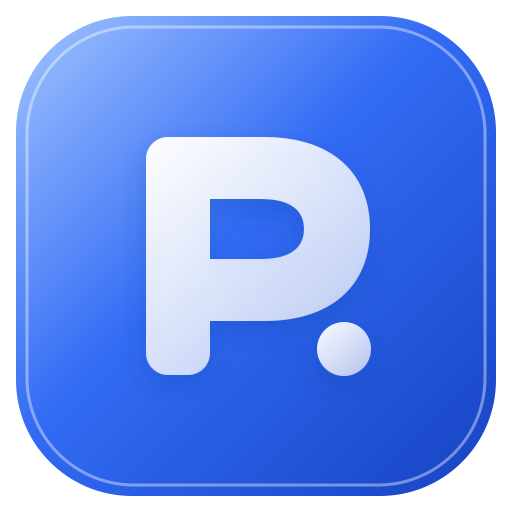

<p align="center"></p>
<h1 align="center">Payday</h1>
<p align="center"><strong>Give your money a plan. Get on with your month.</strong></p>
<p align="center">A Windows desktop budgeting app for payday decisions, occasional adjustments, and the things you want to build towards.</p>
<p align="center"><a href="https://github.com/Juny-max/Payday/releases/latest">Download for Windows</a> &middot; <a href="https://github.com/Juny-max/Payday/issues">Report an issue</a> &middot; <a href="#getting-started">Getting started</a></p>

---

## A budget you do not have to babysit

Payday helps you decide where your salary should go before you spend it. Reserve your commute and optional data, plan food money, set aside savings, and make room for lifestyle purchases and wishlist goals.

You do not need to log every lunch or daily journey. Open Payday when you get paid, when your plans change, or when you need to record borrowing from your savings.

### Four pockets. Your account names.

| Pocket | What it covers |
| --- | --- |
| Savings | Money for your future, with a record of what you owe yourself after borrowing |
| Commute & data | Calendar-based transport estimates and optional internet reserves |
| Feeding | Bulk cooking supplies and meals bought outside |
| Lifestyle & goals | Upkeep, social plans, gifts, and one-time purchases |

The default account names reflect Payday's Ghanaian origins. Rename them in Settings to match the accounts you actually use.

## Getting started

On first use, a guided tour explains each part of Payday. You can skip it or restart it anytime from **Help & getting started**.

1. [Download the latest Windows installer](https://github.com/Juny-max/Payday/releases/latest) and install Payday.
2. Start a payday. Enter your take-home salary, daily return fare, and work weekdays.
3. Review the offline suggestion and adjust your allocations.
4. Save the payday, then make the transfers between your real accounts yourself.
5. Return when something changes, or when you are ready to plan the next payday.

**A stable monthly salary works too.** You can enter the same amount every month for years. Each payday is a separate record, and saving it twice is blocked. Commute estimates still depend on the selected month's calendar. A new payday starts with zero monetary inputs; your existing savings, history and wishlist funding remain.

## What you can do

- Plan manually without an internet connection or external database.
- Split your salary across four named pockets without hiding an unaffordable commute.
- Count actual calendar workdays from your weekly schedule.
- Choose whether to reserve money for data this payday.
- Track wishlist funding and archive bought items.
- Record borrowing from savings and the amount owed back to yourself.
- Read a simple breakdown for each account.
- Export and restore an encrypted backup.
- Switch between real Settings panels for accounts, currency, AI, backups and updates.
- View GHS records in USD or GBP with dated, cached exchange rates.
- Get a Settings badge when an update is available, then choose when to download and install.

## Currency preferences

In **Settings > Currency**, choose Ghana cedis (GHS), US dollars (USD) or British pounds (GBP). For USD/GBP, refresh the reference rates or enter rates manually. Saved rates work offline, show their date and source, and are not refreshed in the background. The rate provider receives currency codes only, never your financial records.

This version converts the **viewing currency**. The underlying records and editable inputs remain in GHS; a visible notice explains this. Switching back restores the original view without rewriting balances or history. Existing notes and AI replies retain their original amounts. These are estimates, not bank exchange quotes, and may differ from rates and fees charged by a bank.

Payday still starts with a Ghana-based budget. Native USD/GBP entry, separate wallets in different currencies and bank transfers across currencies are not supported yet.

## An optional co-pilot

You can add a Google AI Studio key in Settings to chat with Gemini about your budget. Ask a question, describe an upcoming expense, or request a new allocation. The co-pilot receives your message, recent chat, selected budget and limited savings/debt context only when you send a request.

Proposed amounts are validated and presented for review. Chat does not move bank money, and Payday does not know what you have spent since payday unless you record an adjustment. You remain in control of the final plan. The manual planner does not require an API key.

## Your data stays on your device

Financial records and the optional Gemini key are encrypted using Windows credential protection. They are not stored in this GitHub repository. Backups exclude the API key and can be restored only under the same Windows account.

Settings includes a confirmed reset and access to the Windows uninstall wizard. Leave data deletion selected during uninstall to remove Payday's local records and caches. Normal app updates preserve your records.

Downloaded installers, your source checkout and backups stored elsewhere are separate files. See [SECURITY.md](SECURITY.md) for credential and release handling.

## Build it locally

Payday uses Electron, React, TypeScript, Vite and Tailwind CSS. Node.js 22+ is required; build the Windows installer on Windows.

```sh
npm ci
npm run dev
```

```sh
npm test
npm run check:secrets
npm run dist
```

Installers and update metadata are generated in `release/`. Generated builds, caches, local vaults and test captures are excluded from Git. Desktop verification scripts use isolated test data.

## Releases

The public update feed is hosted in [GitHub Releases](https://github.com/Juny-max/Payday/releases). Installed Payday checks shortly after launch (about 20 seconds), then every six hours while open. Waking or focusing the app checks only when overdue. Background connection failures stay quiet and no installer downloads automatically. An Update badge on Settings opens the Updates panel directly; Ready means the downloaded update can be installed. There is no update service running when Payday is closed. A version change on `main` runs the Windows release workflow, including secret scanning, tests and packaging. The workflow uses GitHub's temporary token; no personal publishing token belongs in the app or source.

Older versions without update support need one manual installation of version 1.4.7 or later. After that, use **Settings > Updates**. Current Windows builds are unsigned; download only from this repository's releases.

## Project status

Payday is an actively developed personal budgeting tool. It records plans rather than actual bank balances, does not connect to banks, and does not guarantee that AI suggestions fit every personal situation. Review the figures before committing a payday.

## Open source

Payday is available under the [MIT licence](LICENSE). You may use, modify and redistribute it, including commercially, provided you retain the copyright and licence notice. Third-party dependencies keep their own licences.

Contributions and bug reports are welcome. Open an issue describing the problem or proposed change. Use fictional figures in examples and screenshots, and never include your API key, private vault, backup or GitHub credentials.
